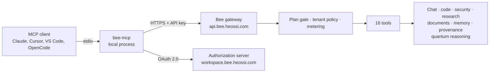

# Bee™ MCP server

Bee MCP exposes **16 governed tools** through the hosted Bee gateway. Every call is authenticated, tenant-scoped, plan-gated and metered. The server runs locally over stdio and forwards tool calls to Bee over HTTPS - no model download, no GPU.

## At a glance

| | |
| --- | --- |
| Transport | stdio locally → streamable HTTP to the gateway |
| Gateway resource | `https://api.bee.heossi.com/mcp` |
| Package | [`bee-sdk`](https://pypi.org/project/bee-sdk/) (`bee-mcp` entry point) |
| Registry identity | `io.github.heossihq/bee-public` |
| Authentication | `bee_sk_…` API key **or** OAuth 2.0 |
| Python | 3.10+ |

## Architecture



OAuth discovery is published at `https://api.bee.heossi.com/.well-known/oauth-protected-resource`; the advertised authorization server is `https://workspace.bee.heossi.com`.

## Tools

| Tool | Name | What it is for |
| --- | --- | --- |
| `bee_chat` | Ask Bee | Use for general or specialist questions that do not require a more specific Bee tool. Returns generated text from the selected domain and model tier.… |
| `bee_code` | Code Assistant | Use for code explanation, bug fixing, refactoring, or test generation. Returns text and proposed code; it does not read files, execute commands, or… |
| `bee_security` | Security Assistant | Use for defensive code audits, threat models, authorized penetration-test support, or smart-contract review. Returns analysis and remediation… |
| `bee_smith_assurance` | Smith EIC Military-Grade Assurance | Commission Smith for an evidence-first critical-systems assurance review of a customer-owned or explicitly authorized target. A Bee-operated run is… |
| `bee_research` | Research Assistant | Use to draft a NISQ-honest quantum-circuit design or critique an ML/CS paper. Returns research text or sample framework code; it does not submit QPU… |
| `bee_verify_provenance` | Verify Agent Provenance | Use to verify a Bee agentic coding session by session_id. Returns verification status, sealed-turn count, and ML-DSA-65 (NIST FIPS 204) signature… |
| `bee_usage` | Account & Usage | Use to inspect the authenticated caller's Bee plan and metered consumption. Returns pooled tokens, per-tier allowances, reset times, and a 24-hour or… |
| `bee_documents_search` | Search Documents | Use to retrieve relevant excerpts from the authenticated tenant's hosted Bee document library. Returns ranked chunks and source labels without… |
| `bee_documents_add` | Add Document | Use only when the user intends to persist supplied text in the authenticated tenant's hosted Bee knowledge base. Creates a searchable document and… |
| `bee_memory_search` | Search Memory | Use to recall facts, preferences, projects, or skills from the authenticated user's Bee memory. Returns ranked memories without changing them and… |
| `bee_memory_add` | Remember | Use only when the user intends Bee to persist a fact for future conversations. Writes to the authenticated user's memory, honors opt-in and tenant… |
| `bee_quantum_reasoning_run` | Run Quantum Reasoning | Use only after the user chooses an eligible hosted quantum product. Creates a durable, tenant-encrypted, metered Quantum Reasoning Lab job that may… |
| `bee_quantum_reasoning_jobs` | List Quantum Reasoning Jobs | Use to list the authenticated tenant's retained Quantum Reasoning Lab jobs and capabilities. Returns paginated metadata without creating or changing… |
| `bee_quantum_reasoning_get` | Get Quantum Reasoning Job | Use to inspect one tenant-scoped Lab job. Returns status, candidates, scores, result, QPU or fallback evidence, usage, and receipt ID without… |
| `bee_quantum_reasoning_remove` | Cancel or Delete Quantum Reasoning Job | Use only after explicit user intent to cancel an eligible queued job or permanently erase content from a terminal job. This is a destructive,… |
| `bee_computer_use_validate_host` | Validate Computer-Use Host | Use to validate a real Bee computer-use host capability report and optional governed action request at the hosted gateway. This tool does not observe… |

## Run (stdio)

```bash
export BEE_API_KEY=bee_sk_…
uvx --from bee-sdk@latest bee-mcp
```

Create a key at [Bee Workspace](https://workspace.bee.heossi.com/account/api-keys). The free Cell tier works for first use.

## Client configuration

Use this in Claude Desktop, Cursor, VS Code, Zed, Windsurf, OpenCode, or any client that supports stdio:

```json
{
  "command": "uvx",
  "args": ["--from", "bee-sdk@latest", "bee-mcp"],
  "env": { "BEE_API_KEY": "${input:beeApiKey}" }
}
```

Never commit a real API key. Client-specific templates are in [`mcp/configs`](./configs).

## Plan gating and metering

The gateway enforces the API key's plan on every call: which model tiers you can reach, tenant policy, token allowance, and usage metering. Model access is a property of the key, not of the client - the same tool call can succeed on one plan and be refused on another. Tool calls never run locally and never see your files unless you pass them in.

## Security posture

- Keys are `bee_sk_…` secrets; treat them as passwords and scope them per integration.
- Calls are tenant-scoped and metered; provenance-sensitive results (for example `bee_verify_provenance`, `bee_smith_assurance`) are returned with their verification evidence rather than a bare pass/fail.
- The gateway, not the client, is the trust boundary. A compromised client cannot exceed the key's plan or tenant.

Live tool catalog and per-client setup: [bee.heossi.com/docs/mcp](https://bee.heossi.com/docs/mcp).
---

Bee™ and the Bee knot logo are trademarks of HEOSSI (Pte.) Ltd., Singapore.
